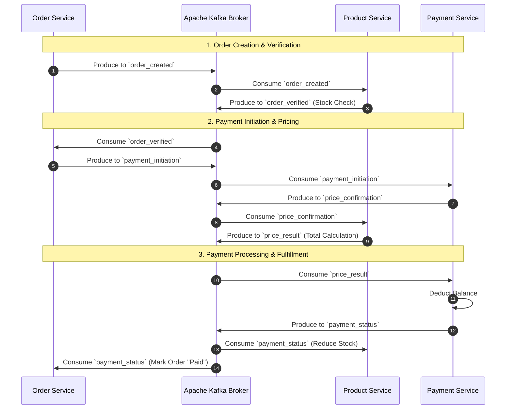

# Distributed E-Commerce Microservices Simulation 🛒📦💳

An event-driven, distributed e-commerce architecture built from scratch in C# (.NET) using **Apache Kafka (KRaft mode)** as the central message broker. This project simulates an asynchronous, decoupled saga choreography workflow across independent domain services (`Order`, `Product`, and `Payment`) running in separate processes.

---

## 🏗️ Architecture & Event Flow

The system uses asynchronous message passing over Kafka topics to coordinate state across isolated services, ensuring loose coupling and resilience.



### 📋 Kafka Topic Schema & Routing
* `order_created`: Emitted when a user creates an order.
* `order_verified`: Emitted by the Product service after checking item availability and stock.
* `payment_initiation`: Triggered by the Order service once verification succeeds.
* `price_confirmation`: Sent by the Payment service to request the pricing breakdown.
* `price_result`: Emitted by the Product service containing the final calculated total cost.
* `payment_status`: Emitted upon successful fund deduction to finalize stock reduction and order status.

---

## ✨ Key Features

* **Decoupled Event Choreography:** Zero direct HTTP or RPC calls between microservices; communication happens exclusively through asynchronous event streams.
* **Distributed State Management:** Independent in-memory storage per service, mirroring real-world database isolation across service boundaries.
* **Dynamic Topic Routing & Deserialization:** Multi-topic stream multiplexing utilizing `JsonNode` and flexible schema deserialization.
* **Concurrency & Background Polling:** Built using non-blocking C# asynchronous background tasks (`Task.Run`) and continuous consumer polling loops.
* **Automated Cluster Lifecycle Management:** Includes custom tooling to clean state, format KRaft storage, and bootstrap Kafka topics.

---

## 🚀 Getting Started & How to Run

### Prerequisites
* [.NET SDK](https://dotnet.microsoft.com/) installed.
* [Apache Kafka](https://kafka.apache.org/) installed locally (configured for KRaft mode).

### Step 1: Start and Provision Kafka
You can use an automated batch script to wipe previous logs, format the KRaft metadata, launch the broker, and provision all six required topics automatically:

```cmd
:: Run your automated reset/setup script
reset-kafka.bat
```

### Step 2: Run the Microservices
Open three separate terminal windows and run each microservice independently:

**Terminal 1 (Product Service):**
```bash
cd service1
dotnet run
```
*(Use the interactive console prompt to add inventory items with a Product ID, Name, Stock, and Price).*

**Terminal 2 (Order Service):**
```bash
cd service2
dotnet run
```
*(Use the interactive prompt to create an order by specifying the Product ID and Quantity).*

**Terminal 3 (Payment Service):**
```bash
cd service3
dotnet run
```
*(Acts as the payment processor, tracking account balance and coordinating payment settlements).*

---

## 🛠️ Tech Stack
* **Language:** C# (.NET Core)
* **Messaging Broker:** Apache Kafka (KRaft mode)
* **Kafka Client:** Confluent.Kafka .NET Client
* **Serialization:** System.Text.Json